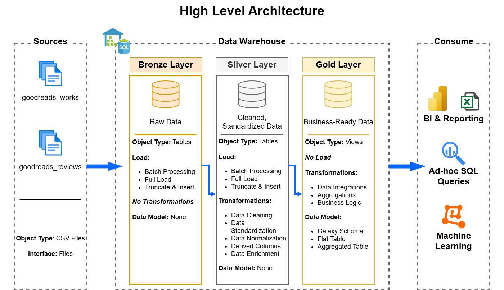
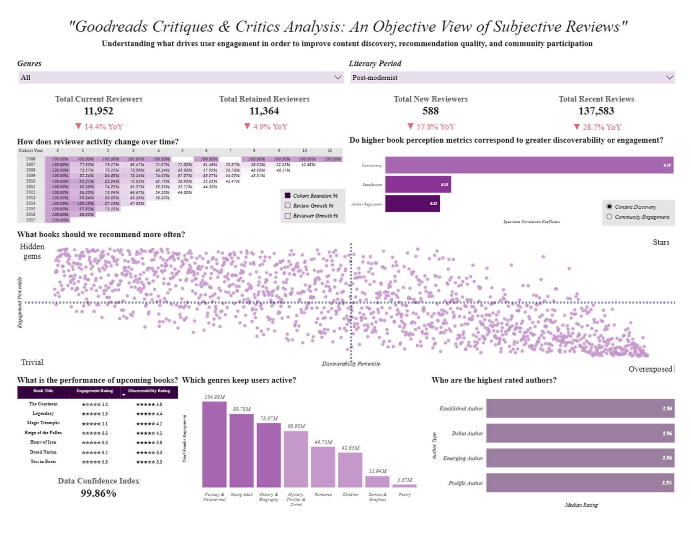

  

<h1 align="center" style="font-size: 56px;">
  Goodreads Data Warehouse and Reviewer Behavior Analysis
</h1>

<h2 align="center" style="font-size: 40px;">
  Project Overview
</h2>

In this project, the following activities were undertaken:

1. **Data Warehouse Architecture Design:** Designed a modern three-layer data warehouse architecture consisting of Bronze, Silver, and Gold layers.
2. **ETL Pipeline Development:** Developed ETL pipelines to ingest source files, transform the data, and transfer it across the respective warehouse layers.
3. **Data Modeling:** Organized the data into fact and dimension tables to support efficient querying and reporting.
4. **SQL-Based Data Analysis:** Performed SQL analyses to answer key business questions and derive actionable insights.
5. **Dashboard Development:** Designed and developed interactive dashboards to visualize key performance indicators, present analytical findings, and support data-driven decision-making.

<h2 align="center" style="font-size: 40px;">
  Project Requirements
</h2>

### Building the Data Warehouse

**Objective:** Design and implement a modern SQL Server data warehouse that consolidates Goodreads reviews and book information into a centralized repository, providing a reliable foundation for analytical reporting and data-driven decision-making.

**Key Activities:**

- **Data Ingestion:** Import the `goodreads_reviews` and `goodreads_works` source datasets from CSV files.
- **Data Quality Management:** Identify, clean, and resolve data inconsistencies and quality issues to ensure data reliability.
- **Data Integration and Modeling:** Transform and integrate both datasets into a structured, analytics-ready data model optimized for efficient querying and reporting.
- **Data Scope:** Work exclusively with the latest available dataset without implementing historical data tracking or historization.
- **Documentation:** Develop comprehensive data model documentation to guide business stakeholders and analytics teams in understanding the data structure and relationships.

### BI: Analytics and Reporting

**Objective:** Develop SQL-based analyses and interactive Power BI dashboards to generate actionable insights into Goodreads platform performance.

**Key Areas of Analysis:**

- **User Behavior:** Examine reading patterns, user engagement, and reviewing activities.
- **Author and Book Performance:** Evaluate book popularity, author performance, and reader reception.
- **Review Trends:** Analyze review patterns, ratings, and changes in reader sentiment over time.

The resulting analytics provide stakeholders with meaningful business metrics and actionable insights to support informed strategic decisions.

<h2 align="center" style="font-size: 40px;">
  Dataset Source and Description
</h2>

The dataset used in this project is publicly available through the [UCSD Goodreads Dataset](https://cseweb.ucsd.edu/~jmcauley/datasets/goodreads.html).

It consists of three primary data categories:

1. **Book Metadata:** Contains descriptive information about books, including titles, authors, and other bibliographic attributes.
2. **User-Book Interactions:** Records users' public bookshelf activities, reflecting their reading preferences and engagement with books.
3. **Detailed Book Reviews:** Contains user-generated reviews and ratings, providing insights into reader feedback and book reception.

These datasets can be integrated by establishing relationships through their corresponding book, user, and review identifiers, creating a unified dataset suitable for analytical processing and reporting.

<h2 align="center" style="font-size: 40px;">
  Data Architecture
</h2>

The data architecture for this project follows Medallion Architecture **Bronze**, **Silver**, and **Gold** layers:

  

1. **Bronze Layer:** Stores raw data as-is from the source systems. Data is ingested from CSV Files into SQL Server Database.
2. **Silver Layer:** This layer includes data cleansing, standardization, and normalization processes to prepare data for analysis.
3. **Gold Layer:** Houses business-ready data modeled into a star schema required for reporting and analytics.

<h2 align="center" style="font-size: 40px;">
  Dashboard Preview
</h2>

The dashboard below provides the Goodreads Product Team with insights into how book, author, genre, and review characteristics relate to user engagement. These insights can help improve book discoverability, recommendation quality, and community participation.

  

<h2 align="center" style="font-size: 40px;">
  Business Value and Organizational Impact
</h2>

Developing this end-to-end analytics project provides several strategic benefits to the Goodreads Product Team by transforming large volumes of user-generated reviews and behavioral data into actionable business insights.

**1. Identifying Emerging Trends and Changing User Preferences**

Reader preferences, interests, and engagement patterns continuously evolve. Books, genres, and themes that attract significant attention today may lose popularity over time. This project enables the team to monitor changing reader behavior, identify emerging trends, and recognize shifts in user interests. These insights can support timely product decisions, allowing Goodreads to capitalize on emerging opportunities while they remain relevant. 

**2. Establishing Objective and Consistent Performance Measurements**

Concepts such as book controversy, author reputation, and reader satisfaction are inherently subjective and susceptible to varying interpretations. This project addresses this challenge by translating these concepts into measurable indicators using consistent analytical methodologies. Standardized measurements enable the team to compare books, authors, and reader responses more objectively, supporting data-driven evaluations and more consistent decision-making.

**3. Transforming Unstructured Reviews into Actionable Insights**

User reviews contain valuable qualitative information, but their unstructured textual format makes large-scale analysis and comparison challenging. This project applies analytical techniques to extract meaningful patterns and translate qualitative review characteristics into quantitative metrics. By making review information measurable and comparable, the team can better understand reader sentiment, evaluate engagement patterns, and identify factors associated with user satisfaction.
